<p align="center">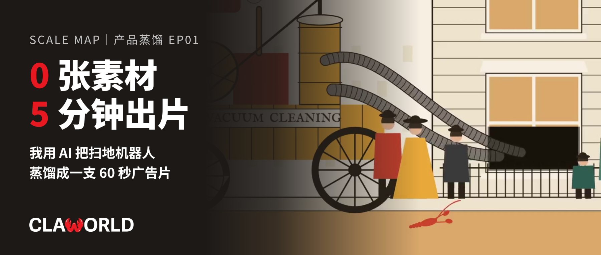</p>

# Scale Map｜产品蒸馏

**一个产品名，一支科普软广。**

每个产品，开始都是人类懒惰的发明；到了今天，都可以是一支广告。Scale Map 把一个产品放回人类文明的尺度里：从人想少干哪件累活讲起，一代代讲到今天，你的产品正好出场；最后问一句，当这个需求被彻底解决，它还需要存在吗？

成片的每一帧画面、每一个音符都是代码写的，没有图片素材。最简单的一支完整短片，从一句话到带配乐的成片，实测 5 分钟，人只动手一次：挑画风。第一期扫地机器人前后花了 50 分钟，多出来的时间用在深化故事、打磨画风和加广告素材上。

> **Never decorate history. Visualize it.**
> 不要拿历史做装饰，要让视觉本身承担叙事。

<p align="center">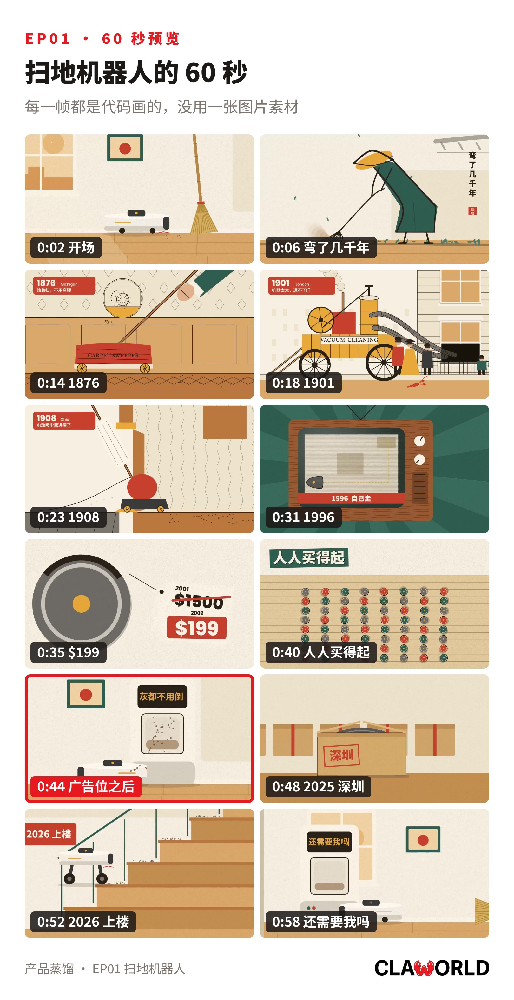</p>

**新手从这里开始：[使用教程](docs/教程.md)**，从装环境到交付一期，每一步都有命令和截图。仓库为什么这样拆，见 [仓库设计](docs/设计.md)。

## 产品

每个产品是一个独立的子仓库，挂在 `products/<slug>/`。下表由 `tools/products.sh --write` 从各期的 `product.yaml` 生成。

<!-- products:start -->
| 期 | 产品 | 结尾问题 | 状态 | 子仓库 |
|---|---|---|---|---|
| EP01 | [扫地机器人](products/robot-vacuum/) | 地面自己会干净的那天，还需要扫地机吗？ | 预览已出 | `scale-map-robot-vacuum` |
<!-- products:end -->

下一期：洗碗机，讲人类为了不洗碗折腾了多少年。

## 为什么做

想拍一支讲清楚「产品为什么存在」的片子，现有的路都卡在某一处：找团队拍要按周排期，改一个镜头要重排；AI 视频生成快，但画风在飘、史实会编、只能整段重抽；长图文能写出处，但少有人看完。做科普的有流量没广告位，做广告的有预算没人看。

Scale Map 想走第四条路：画风统一，史实有出处，每一帧都能改，广告天生长在故事里。

<p align="center">
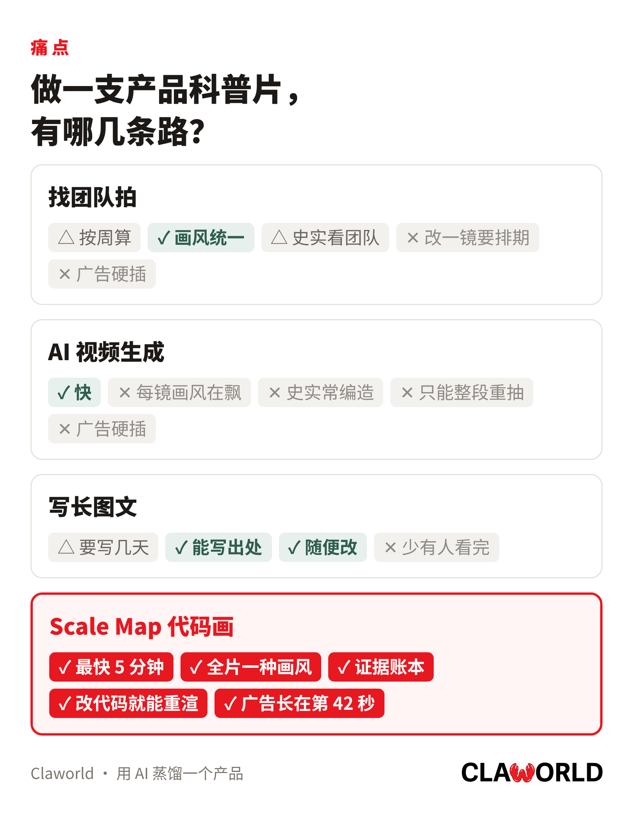
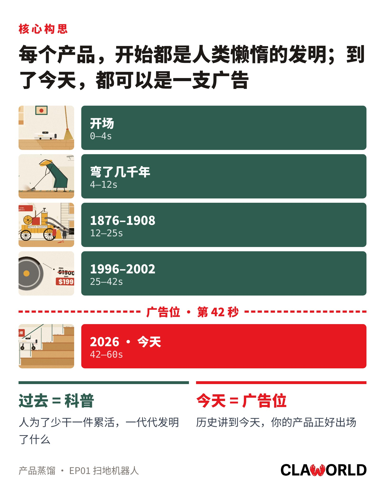
</p>

片子结构固定：前面讲人类怎么一代代偷懒（科普），在「今天」那一段之前留一个硬切点（广告位，EP01 在第 42 秒），后面讲今天，结尾抛出消失之问。

## 怎么做

整套东西由两半拼起来：讲故事的方法（本仓库的 [SKILL.md](SKILL.md) 和 [references/](references/)），加上画动画的引擎（[huashu-art-motion](https://github.com/alchaincyf/huashu-art-motion)，本仓库 [motion/](motion/) 负责接上它）。

<p align="center">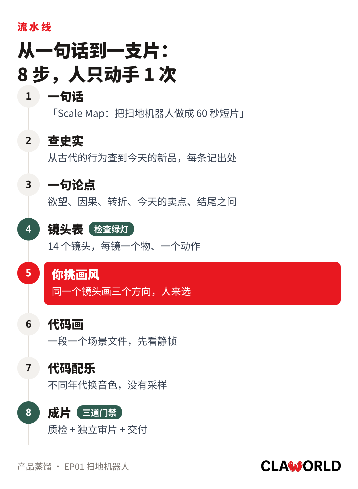</p>

**先查清楚，再动笔。** 拿到一个产品，先把六层地图查清楚，再压成一句论点。地图是研究模型，成片只用最强的那条因果线。

<p align="center">
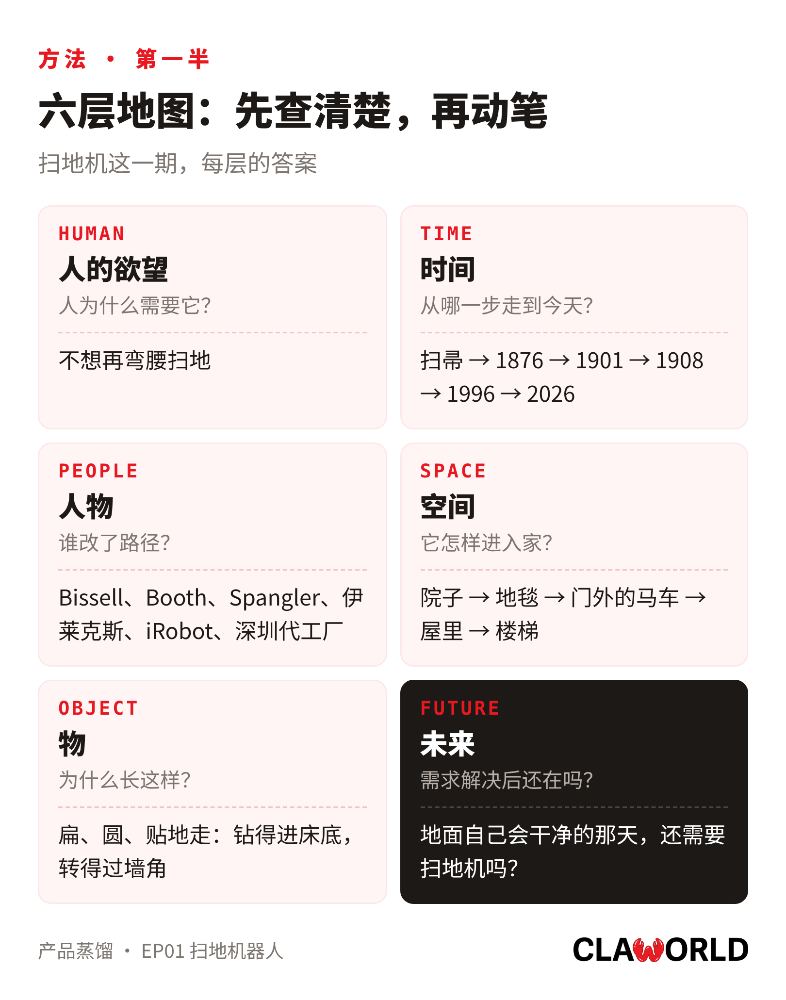
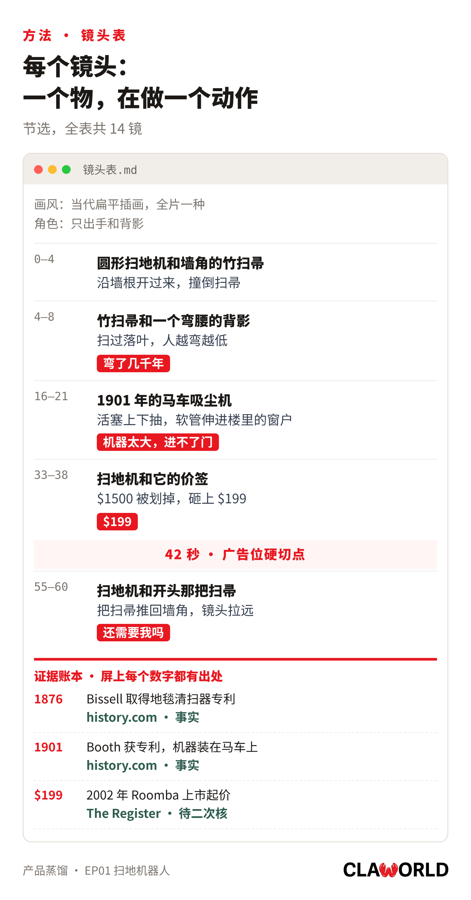
</p>

- **HUMAN｜人的欲望**：人为什么需要它？
- **TIME｜时间**：从原始行为经过哪些节点走到今天？
- **PEOPLE｜人物**：谁真正改变了路径？
- **SPACE｜空间**：它怎样进入家庭、建筑、城市和生活？
- **OBJECT｜物**：它为什么形成今天的形态？
- **FUTURE｜未来**：需求被彻底解决后，它还会存在吗？

**镜头表是合同。** 论点拆成 12–16 个镜头，每个镜头只做一件事：一个物，在做一个动作。表后附证据账本，屏上每个年份、价格都写出处，查不到的标「待核」，不许上屏。镜头表检查不过，不写一行动画代码。

**一种画风。** 动手前把同一个镜头画成三个方向让人挑。默认全片单一画风：当代扁平插画，加印刷颗粒，六色板，年代靠物件、建筑和图注牌区分。EP01 第一版试过四种媒介接力，60 秒换四次画风太乱，已经改掉；媒介接力只留给旗舰集。

<p align="center">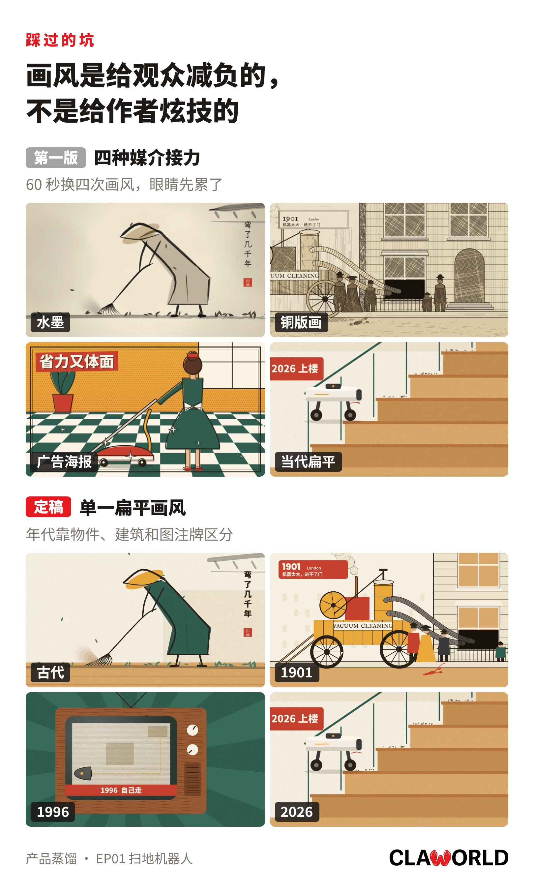</p>

**门禁。** 质检、独立审片（派一个没参与制作的 agent 只看成片）、交付，任何一个红灯都不交付。

## 两种成品

**短片（60–90 秒，代码绘制）**：12–16 个镜头，单一画风，纯代码配乐，过三道门禁。

**图文（5–8 张，默认 6 张）**：HOOK、BEFORE、TURNING POINT、EVOLUTION、NOW、AFTER，每张只承担一个观点，配可生成的图像 brief。

两种成品共用研究、论点、六帧故事、证据账本和角色规范。短片是把图文的因果主线放进时间里，不是另讲一个故事。


## 角色：放进你自己的 IP 和宠物

<p align="center">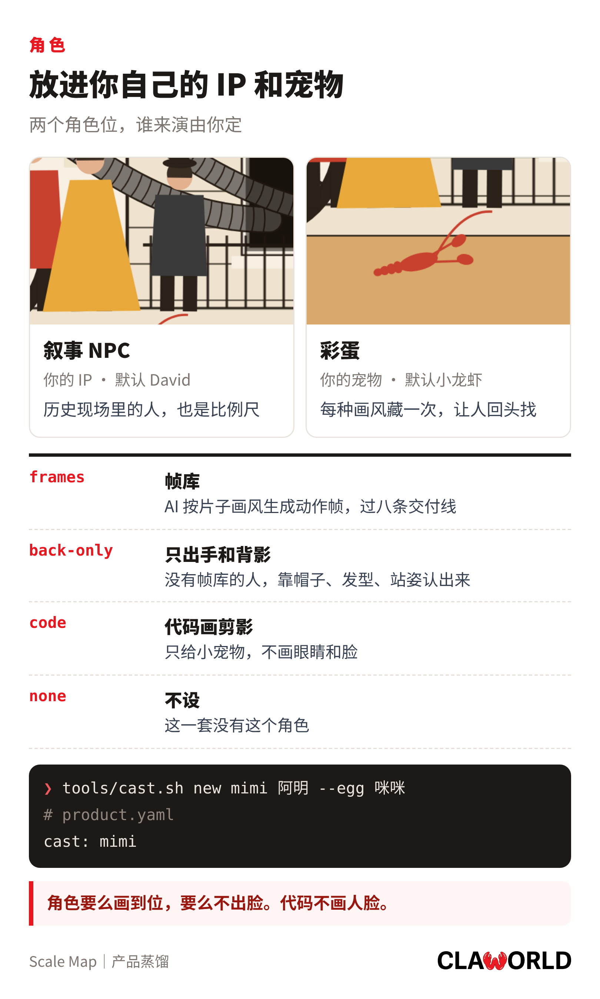</p>

每支片子有两个角色位，谁来演由你定：

- **叙事 NPC**：你的 IP。属于历史现场的人，也是画面的比例尺；不当主持人，不对镜头讲解，短片里最多出现在两段。
- **彩蛋**：你的宠物或吉祥物。每种画风最多藏一次，负责一点荒诞，让人回头再找一遍。

系列默认是 David ＋ 小龙虾。换成你自己的猫、狗、品牌吉祥物或你本人：

```sh
tools/cast.sh new mimi 阿明 --egg 咪咪      # 建在 ~/.config/scale-map/cast/，不进仓库
# 写定规、放参考图和帧库，然后在产品的 product.yaml 里写  cast: mimi
tools/cast.sh check mimi
```

规矩借鉴 [huashu-art-motion](https://github.com/alchaincyf/huashu-art-motion) 的角色规范：角色要么画到位，要么不出脸。每个角色位选一条路：用 AI 按片子画风生成的**帧库**（要过八条交付线）、**只出手和背影**、代码画的**剪影**（只给小宠物），或者**不设**。代码不画人脸。场景代码统一用 `SM.npc` / `SM.egg` 放角色，换卡司不用改场景。完整做法见 **[cast/README.md](cast/README.md)**。

## 快速开始

```sh
# 1. 拉仓库（连同所有产品子仓库），装成 Skill
git clone --recurse-submodules https://github.com/David0936/scale-map.git ~/.claude/skills/scale-map

# 2. 装动画引擎和依赖（另需 uv、ffmpeg）
npx skills add alchaincyf/huashu-art-motion
uv run --with playwright playwright install chromium

# 3. 在 Claude 里说一句话
#    Scale Map：把洗碗机做成 60 秒短片

# 4. 新开一期、接引擎、出目录
cd ~/.claude/skills/scale-map
tools/new-product.sh dishwasher 洗碗机 2
motion/sync.sh products/dishwasher/films/60s
tools/products.sh --write
```

每一步的细节、截图和常见问题见 **[使用教程](docs/教程.md)**。

## 仓库结构

<p align="center">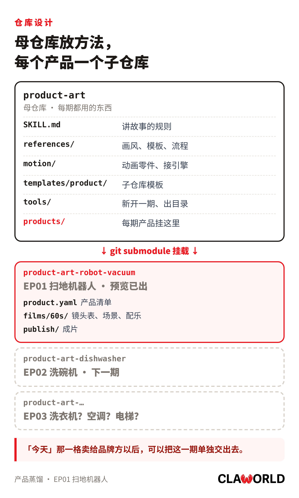</p>

母仓库放每期都用的方法和工具，每个产品一个子仓库。「今天」那一格卖给品牌方以后，可以把这一期单独交出去。

| 路径 | 内容 |
|---|---|
| [SKILL.md](SKILL.md) | 给 AI 的执行规则：六层地图、五个阶段、质量门 |
| [references/style-bible.md](references/style-bible.md) | NPC 和彩蛋怎么出场、历史媒介、构图（含短片部分） |
| [references/cast.md](references/cast.md) | 给 AI 的卡司规则：查找顺序、三条路、交付线 |
| [references/deliverable.md](references/deliverable.md) | 完整交付格式（图文与短片） |
| [references/film-pipeline.md](references/film-pipeline.md) | 从六帧到镜头表、屏上字、搭建、EP01 踩过的坑、门禁 |
| [references/media-relay.md](references/media-relay.md) | 媒介接力（旗舰集可选）对照表 |
| [references/storyboard-template.md](references/storyboard-template.md) | 镜头表模板 |
| [cast/](cast/) | 卡司：你的 IP 和宠物。默认 `david/`，模板 `_template/`，[怎么做](cast/README.md) |
| [motion/](motion/) | 动画零件 `scale_map_kit.js`（含 `SM.npc` / `SM.egg`）和接引擎的 `sync.sh` |
| [templates/product/](templates/product/) | 产品子仓库模板 |
| [tools/](tools/) | `new-product.sh` 新开一期；`products.sh` 生成产品目录；`cast.sh` 建卡司、查卡司 |
| [docs/](docs/) | [使用教程](docs/教程.md)、[仓库设计](docs/设计.md)、配图、系列介绍 PDF |
| [products/](products/) | 各期产品子仓库 |

## 怎么赚钱

<p align="center">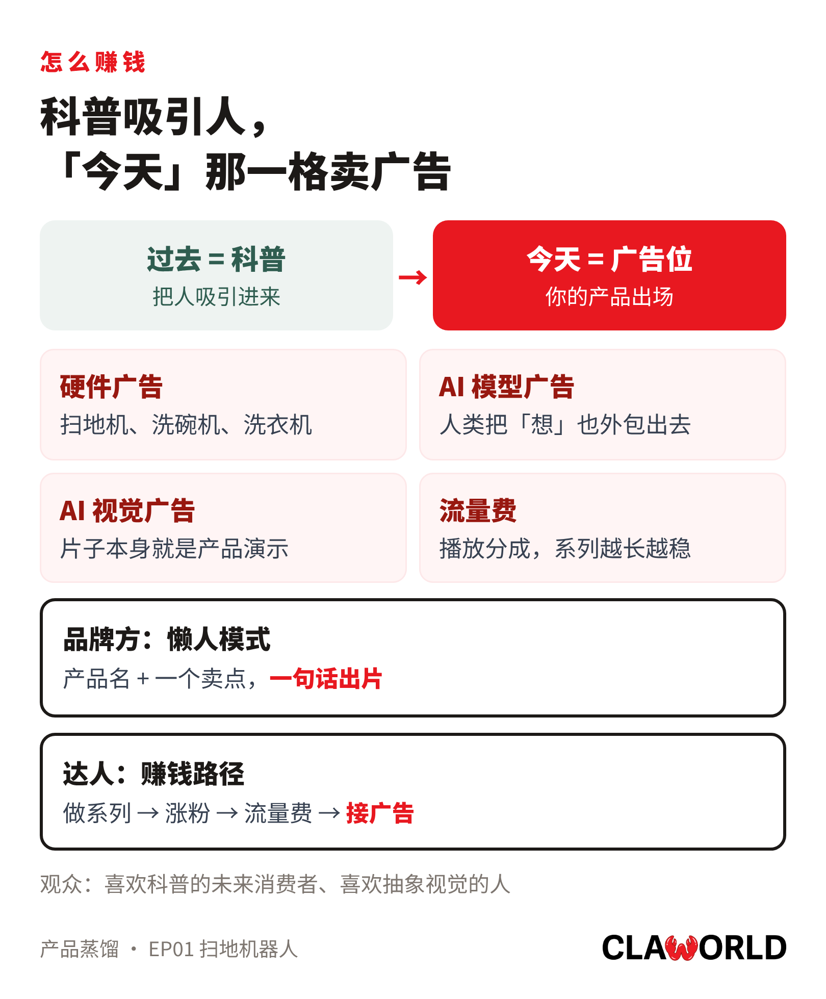</p>

科普负责吸引人，「今天」那一格负责卖：硬件厂商（扫地机、洗碗机、洗衣机）、AI 模型公司（人类连「想」都开始外包）、AI 视觉公司（片子本身就是产品演示），再加平台流量分成。品牌方走懒人模式，一个产品名加一个卖点，一句话出片；达人做系列、涨粉、拿流量费、接广告。
