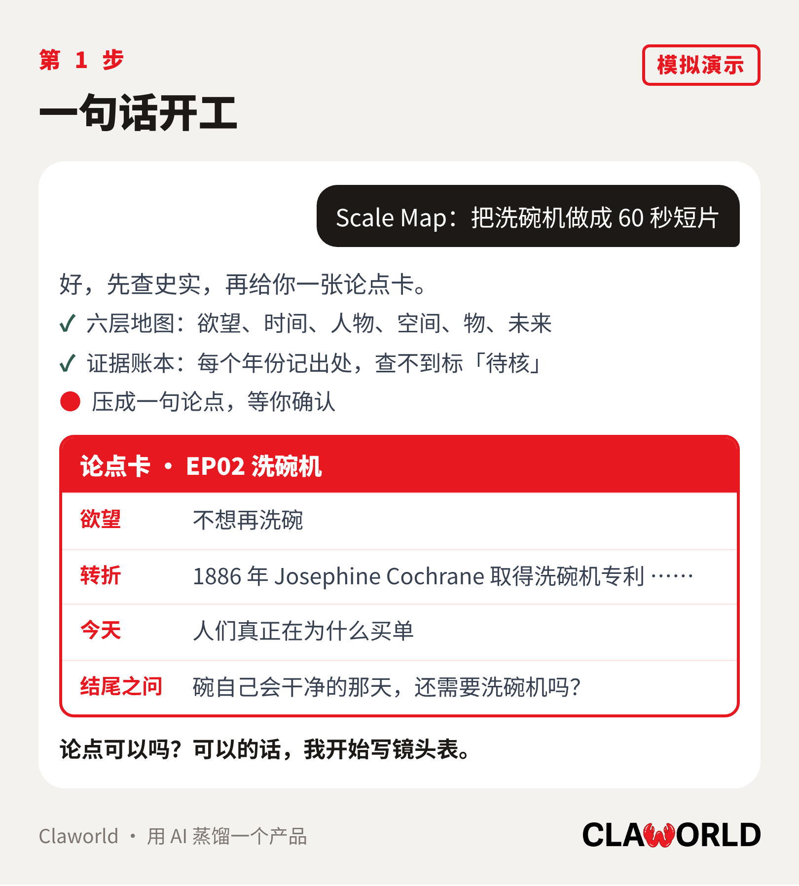
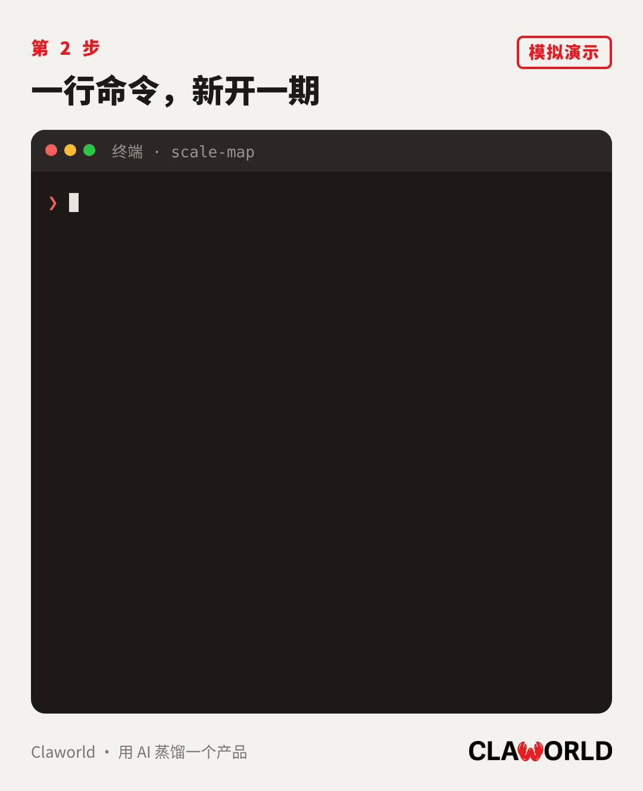
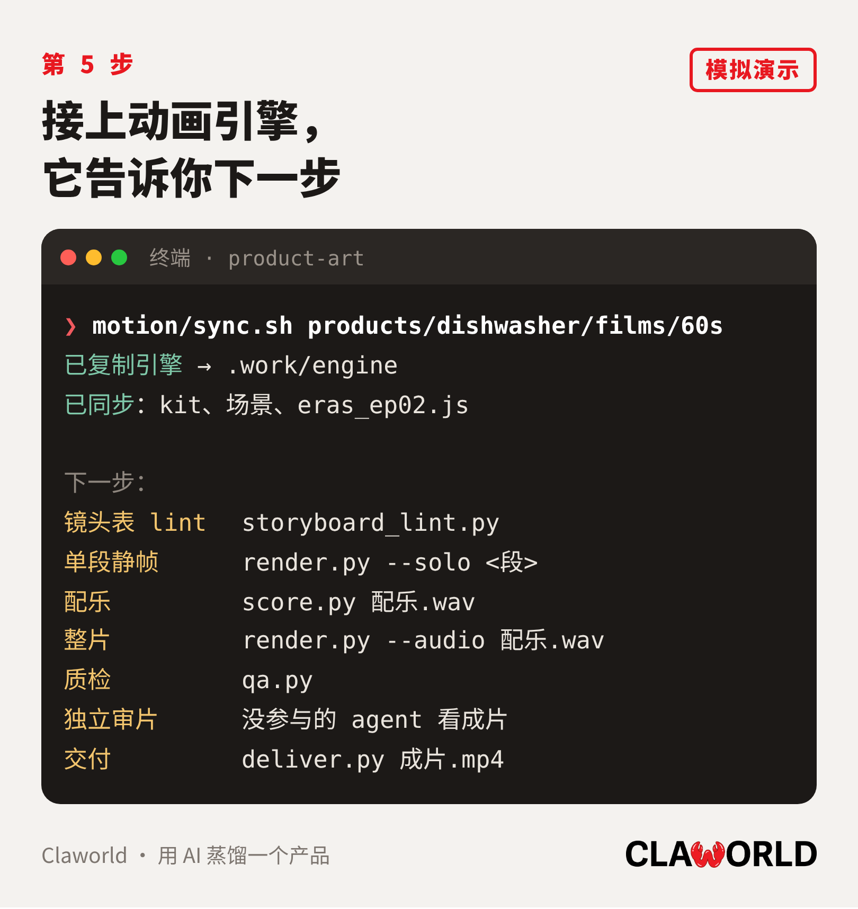
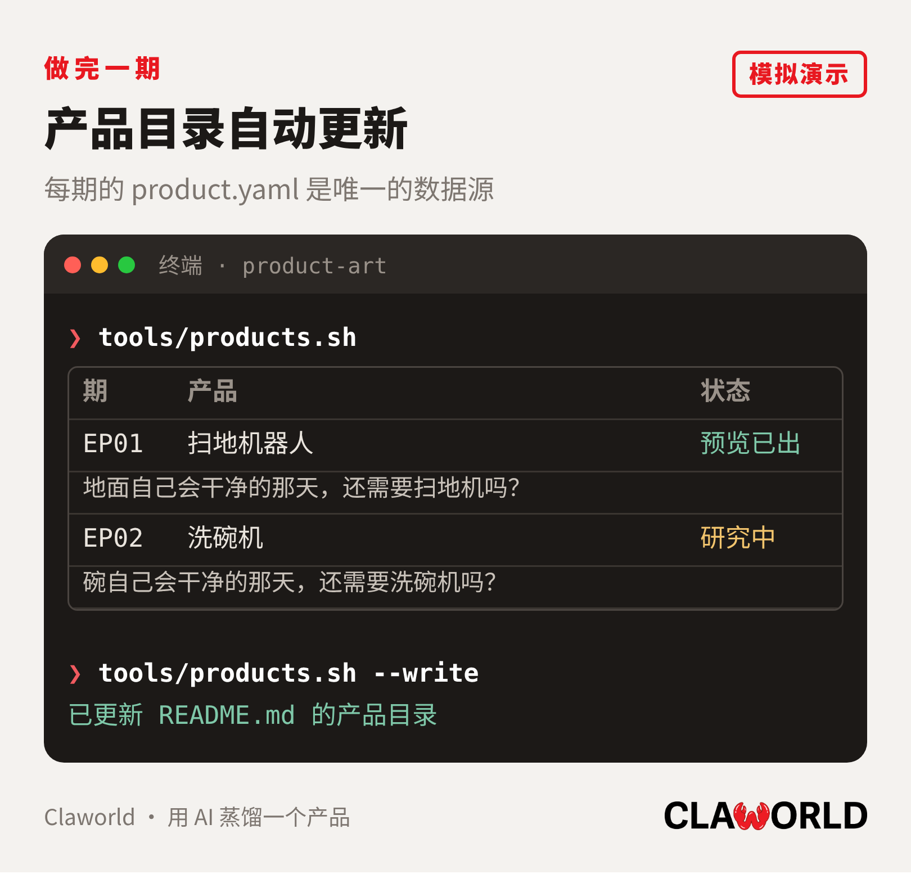

# 使用教程：从一句话到一支片

这份教程带你完整做一期产品蒸馏短片。例子用第二期洗碗机；第一期扫地机器人是完整的参考实现，在 [products/robot-vacuum](../products/robot-vacuum/)。

<p align="center"></p>

整条流水线 8 步，人只需要做两件事：说一句话，挑一个画风。剩下的由 AI 按 [SKILL.md](../SKILL.md) 的规则完成，每到一道门禁会停下来检查。

## 0. 准备

| 需要 | 用来做什么 | 怎么装 |
|---|---|---|
| Claude（或其他支持 Skill 的 agent） | 研究、写镜头表、写场景代码 | 本仓库根目录的 `SKILL.md` 就是 Skill |
| huashu-art-motion | 渲染引擎和门禁脚本 | `npx skills add alchaincyf/huashu-art-motion` |
| uv | 跑引擎的 Python 脚本 | 见 uv 官网 |
| ffmpeg | 合成视频 | `brew install ffmpeg` |
| Playwright Chromium | 在浏览器里逐帧渲染 | `uv run --with playwright playwright install chromium` |
| git | 母仓库和产品子仓库 | 系统自带 |

把仓库装成 Skill（连同所有产品子仓库一起拉）：

```sh
git clone --recurse-submodules https://github.com/David0936/product-art.git ~/.claude/skills/scale-map
# 已经 clone 过、子仓库是空的：
git -C ~/.claude/skills/scale-map submodule update --init
```

用 Codex 的话，放到 `~/.codex/skills/scale-map`，`agents/openai.yaml` 里有它的显示名和默认提示。

`motion/sync.sh` 会依次在 `~/.claude/skills`、`~/.agents/skills`、`~/.codex/skills` 下找 huashu-art-motion；装在别处就设环境变量 `HUASHU_DIR`。

## 1. 一句话开工

在 Claude 里说：

```
Scale Map：把洗碗机做成 60 秒短片
```

只要图文就说「Scale Map：蒸馏洗碗机」，默认出 6 张。

<p align="center"></p>

AI 先按六层地图查史实，记证据账本，然后交回一张论点卡：人的欲望、因果论点、3–6 个关键转折、今天人们真正为什么买单、结尾的消失之问。

这一步你要做的是**确认论点**。论点立不住，让它接着查或者缩小题目，不要急着画。

<p align="center"></p>

## 2. 建产品子仓库

在母仓库根目录跑：

```sh
tools/new-product.sh dishwasher 洗碗机 2
```

<p align="center"></p>

参数依次是 slug（小写英文加连字符，也是子仓库名的后半截）、中文名、期数（不填就按现有产品数加一）。它会：

1. 从 `templates/product/` 生成 `../product-art-dishwasher`，替换好名字和期数，做第一次提交；
2. 把它作为 submodule 挂到 `products/dishwasher`，`.gitmodules` 里写 GitHub 地址；
3. 打印接下来要做的事。

然后在 GitHub 建一个空仓库 `product-art-dishwasher`，推上去：

```sh
git -C ../product-art-dishwasher push -u origin main
```

GitHub 用户名不是 David0936 的话，建之前设 `OWNER=你的用户名`。

建好后的子仓库长这样：

```
product-art-dishwasher/
├── product.yaml          产品清单
├── README.md
├── films/60s/
│   ├── 镜头表.md
│   ├── eras_ep02.js      段落清单
│   └── scenes/           每段一个场景文件
└── publish/              交付的成片
```

先把 `product.yaml` 里的 `desire`、`thesis`、`question` 三行填上，用论点卡里的话。字段说明见 [设计.md](设计.md#productyaml)。

## 3. 写镜头表，过检查

AI 把论点拆成 12–16 个镜头，按 [镜头表模板](../references/storyboard-template.md) 写进 `films/60s/镜头表.md`：

- 每个镜头只写一个物和它的一个动作，比如「1901 年的马车吸尘机，活塞上下抽，软管伸进楼里的窗户」；
- 第一个镜头是今天的产品在做一件小事，不出字；最后一个镜头是产品自己的动作，消失之问写在场景里的物上；
- 屏上字每镜不超过 8 个字；
- 「今天」那一段之前标一个广告位硬切点；
- 表后附证据账本，屏上每个年份、价格、数字都要有出处，并标「事实／解读／推测」。

<p align="center"></p>

然后跑检查（命令在第 5 步 `sync.sh` 打印的列表里也有）：

```sh
uv run <huashu>/scripts/storyboard_lint.py products/dishwasher/films/60s/镜头表.md
```

**检查不亮绿灯，不写一行动画代码。**

## 4. 挑画风

AI 把最有画面感的那个转折点画成三个方向，三种不同的构图，出一张对比图让你选。EP01 的三个方向在 [products/robot-vacuum/films/60s/previews/style_directions.jpg](../products/robot-vacuum/films/60s/previews/style_directions.jpg)。

默认是全片单一画风：当代扁平插画，印刷颗粒，六色板，年代靠物件、建筑和图注牌区分。选定以后全片不再换。

<p align="center"></p>

EP01 第一版试过「时代媒介接力」，水墨、铜版画、广告海报、扁平插画各画一段，60 秒换四次画风，观众眼睛先累了，最后统一成一种。媒介接力只留给旗舰集，规则见 [media-relay.md](../references/media-relay.md)。

## 5. 画，然后渲染

AI 一段一个场景文件写进 `films/60s/scenes/`，都基于 `motion/kit/scale_map_kit.js`（脉冲镜头、镜内硬切、线条沸腾、扁平零件）；段落清单写进 `eras_ep02.js`；配乐写成 `score.py`，可以从 EP01 的 [score.py](../products/robot-vacuum/films/60s/score.py) 复制改写。

写完跑：

```sh
motion/sync.sh products/dishwasher/films/60s
```

<p align="center"></p>

第一次跑会把引擎复制到 `films/60s/.work/engine`，之后每次只同步 kit、场景和段落清单。它会打印这一片专用的命令，在 `.work/engine` 里按顺序跑：

| 做什么 | 命令（sync.sh 打印的完整版带好了路径） |
|---|---|
| 镜头表检查 | `uv run storyboard_lint.py 镜头表.md` |
| 单段静帧 | `uv run --with playwright python render.py --film ep02 --solo <段id> --stills 0.5,2 --no-counter --out 静帧/<段id>` |
| 配乐 | `python3 score.py 配乐.wav` |
| 整片 | `uv run --with playwright python render.py --film ep02 --fps 30 --out 渲染/成片.mp4 --audio 配乐.wav` |

**先看每段的静帧再渲整片。** 检查三件事：主体占画面一半以上；画面边缘没有空画布；人物只出背影、剪影或手，代码不画脸。

## 6. 过门禁，交付

同样照 `sync.sh` 打印的完整命令跑，这里是简写：

```sh
uv run qa.py --project <引擎目录> --film ep02 --out qa             # 质检
# 独立审片：派一个没参与制作的 agent，只给它看成片，结论写进 审片/
uv run deliver.py 渲染/成片.mp4 --qa qa --root . --out output      # 交付
```

三道门禁任何一个红灯都不交付。黄灯可以交付，但要在 `交付说明.md` 里写一句理由。

交付后：

1. 成片放进子仓库的 `publish/`；
2. `product.yaml` 的 `status` 改成 `gated`（门禁全绿）或 `published`（已发布），填上 `preview` 路径和广告位秒数；
3. 在母仓库跑 `tools/products.sh --write`，README 的产品目录会自动更新。

<p align="center"></p>

## 提交顺序

子仓库是独立仓库，母仓库只记一个指针，所以**先推子仓库，再推母仓库**：

```sh
cd products/dishwasher
git add -A && git commit -m "EP02 镜头表" && git push
cd ../..
git add products/dishwasher README.md && git commit -m "EP02 进度" && git push
```

反过来推，别人拉母仓库时会找不到那个提交。

## 交给品牌方

只交一期：给对方那个子仓库的访问权限，或者打一个文件包：

```sh
git -C products/dishwasher bundle create ../dishwasher.bundle --all
```

对方 `git clone dishwasher.bundle` 就能拿到这一期的镜头表、证据、代码、配乐和成片，不会碰到其他期。

## 常见问题

**`sync.sh` 说找不到 huashu-art-motion。** 先 `npx skills add alchaincyf/huashu-art-motion`；装在别的位置就 `HUASHU_DIR=/path/to/huashu-art-motion motion/sync.sh ...`。

**说片名不合法。** 引擎的片名来自 `eras_<片名>.js`，只能用小写字母、数字和下划线。模板默认是 `ep02` 这种。

**clone 下来 `products/` 里是空的。** 没带 `--recurse-submodules`，补一句 `git submodule update --init`。子仓库还没推上 GitHub 的话也会拉不下来。

**屏上的某个数字查不到可靠出处。** 证据账本里标「待核」，这个数字就不上屏，换成一个物或一个动作来表达。

**想做 90 秒或竖版。** 在子仓库 `films/` 下再建一个目录（如 `films/90s/`），复用场景代码，只换段落清单和镜头；`product.yaml` 的 `films` 里加一条。

## 更多

- [SKILL.md](../SKILL.md)：给 AI 的完整规则
- [references/film-pipeline.md](../references/film-pipeline.md)：短片流程和 EP01 踩过的坑
- [设计.md](设计.md)：仓库为什么这样拆、`product.yaml` 字段
